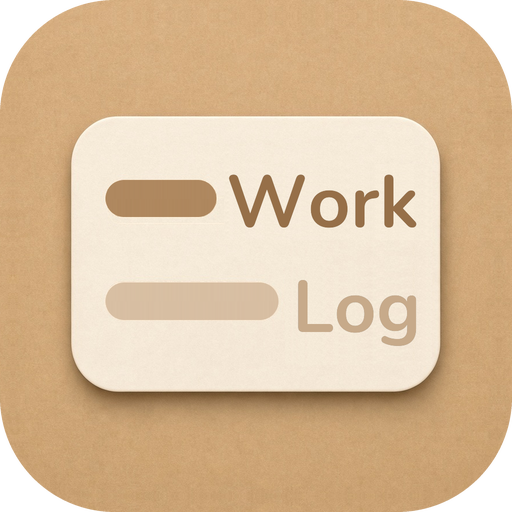

<p align="center">
  
</p>

# WorkLog

本地、单用户的 Mac 工作日志。在日、周、月视图里记下每天做了什么，需要汇报时导出 Markdown。

## 版本记录

新版本写在上面，以前的版本留在下面。打开 DMG 后把 WorkLog.app 拖进「应用程序」；ZIP 则先解压，再把应用放进去。这些安装包没有经过 Apple 公证，第一次打开时在 Finder 里按住 Control 点按应用，选择「打开」。

### 0.0.4

2026-11-02 · 需要 macOS 14 或更高版本

- 可以设置全局快捷键，唤起一个从屏幕顶部拉下来的添加窗口。WorkLog 开着时，在别的软件里也能用。可以设组合键，也可以双击 ⌃、⌥ 或 ⌘。双击要在系统设置的辅助功能里允许 WorkLog。
- 这个窗口可以选亮色、暗色，或跟随系统外观。
- 描述输入时，会列出最近一个月里相近的事项。选中后填上描述和类型。
- 描述框可以一键清空。取消旁边有重置：添加时清掉日期以外的内容，编辑时回到上次保存的样子。
- 日、周、月视图里，选中一条事项后按回车进入编辑。添加和编辑框里可以用复制、粘贴、剪切和撤销。

- [WorkLog-0.0.4.dmg](https://github.com/bang668/WorkLog/releases/download/v0.0.4/WorkLog-0.0.4.dmg)
- [WorkLog-0.0.4.zip](https://github.com/bang668/WorkLog/releases/download/v0.0.4/WorkLog-0.0.4.zip)

### 0.0.3

2026-10-31 · 需要 macOS 14 或更高版本

- 周视图和月视图里，左右方向键换到前一天或后一天，上下方向键在这一天的事项之间切换。日视图里，四个方向键在事项卡片之间移动。
- 切到日视图或周视图时，左边对应的月份保持选中。
- 设置窗口盖在主窗口上面，关掉设置才能回到日志。通用页里「开机启动」放在「编辑方式」上面。
- 关于页最下方有「项目主页」，点开后到 GitHub 上的这个项目。
- 下方查看的描述宽度定为 270。日期那一列收窄了一些。

- [WorkLog-0.0.3.dmg](https://github.com/bang668/WorkLog/releases/download/v0.0.3/WorkLog-0.0.3.dmg)
- [WorkLog-0.0.3.zip](https://github.com/bang668/WorkLog/releases/download/v0.0.3/WorkLog-0.0.3.zip)

### 0.0.2

2026-10-29 · 需要 macOS 14 或更高版本

- 周视图和月视图里，点中某一天后可以粘贴。点到日期以外的地方，选中框还在，颜色变浅，这时粘贴不起作用。日视图不能粘贴。
- 点中一条事项可以复制，再到另一天粘贴成新的事项。
- 设置里的二级类型改成标签。点标签后面的加号添加，双击标签修改，点叉删除，也可以拖动排序。
- 下方查看的描述固定为一定宽度。字太多会换行，再多就在这一列里滚动。备注占用右边剩下的宽度。

- [WorkLog-0.0.2.dmg](https://github.com/bang668/WorkLog/releases/download/v0.0.2/WorkLog-0.0.2.dmg)
- [WorkLog-0.0.2.zip](https://github.com/bang668/WorkLog/releases/download/v0.0.2/WorkLog-0.0.2.zip)

### 0.0.1

2026-10-27 · 需要 macOS 14 或更高版本

首次发布。日志记在这台 Mac 的一个文件夹里。

- 日、周、月三种视图
- 添加和编辑用半抽屉；查看可以放在右侧、下方，或点开后直接编辑
- 事项有描述、备注，以及一级、二级类型
- 导出 Markdown，或复制到剪贴板
- 从文本导入旧记录。日期单独一行，事项缩进写在下面。已有事项只追加，同一天里描述相同的不再写入
- 可以设置登录后自动打开

- [WorkLog-0.0.1.dmg](https://github.com/bang668/WorkLog/releases/download/v0.0.1/WorkLog-0.0.1.dmg)
- [WorkLog-0.0.1.zip](https://github.com/bang668/WorkLog/releases/download/v0.0.1/WorkLog-0.0.1.zip)

## 环境

- macOS 14 或更高版本
- 从源码编译需要 Xcode 15 或更高版本

## 编译

```bash
open WorkLog.xcodeproj
```

选择 **WorkLog** 这个 scheme，然后运行（⌘R）。也可以在终端执行：

```bash
xcodebuild -project WorkLog.xcodeproj -scheme WorkLog -configuration Debug -destination 'platform=macOS' build
xcodebuild -project WorkLog.xcodeproj -scheme WorkLog -destination 'platform=macOS' test
```

Debug 编译完成后，用 Xcode 直接运行，或到 DerivedData 里找到生成的应用。

## 许可证

保留所有权利。发布页上的安装包可以下载使用。源码没有开放许可。
